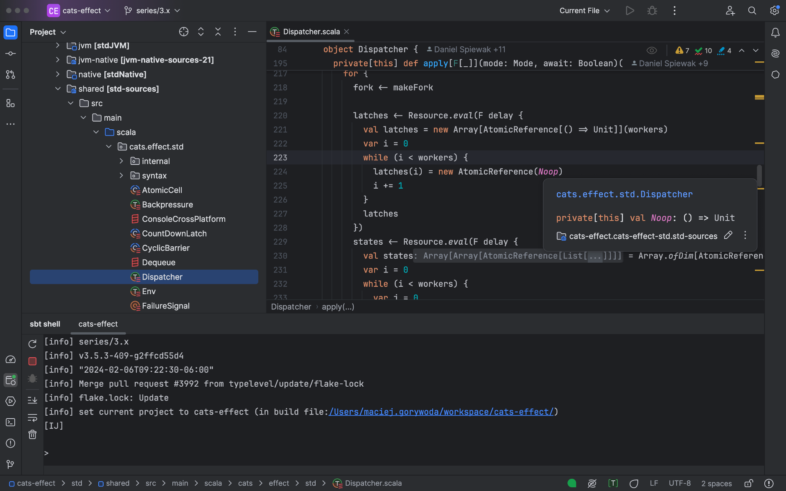
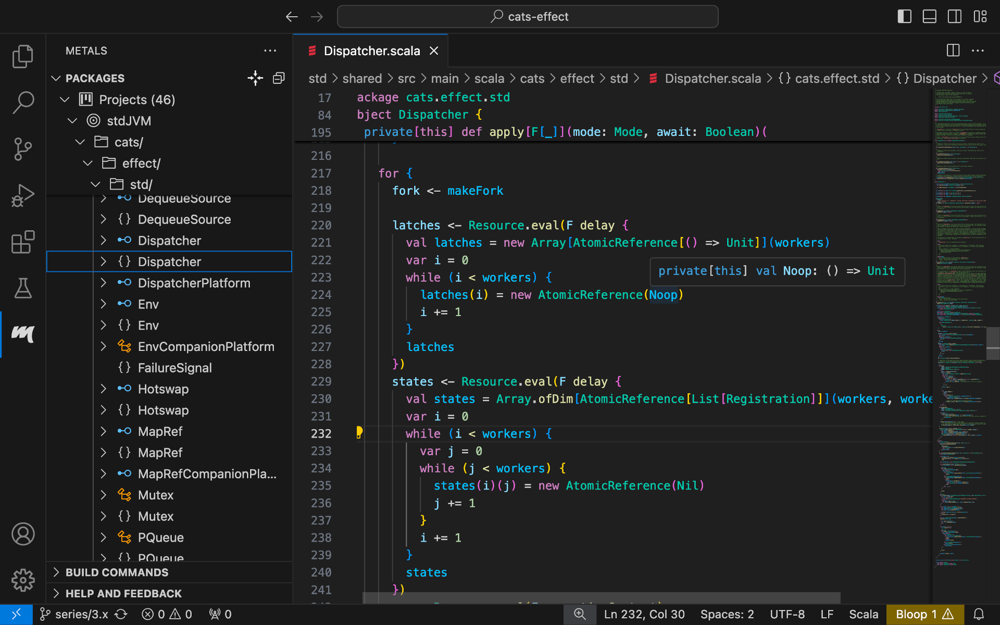

Por supuesto, es posible escribir código Scala en cualquier editor y compilarlo y ejecutarlo desde la línea de comandos. Pero la mayoría de los desarrolladores prefieren usar un IDE (Entorno de Desarrollo Integrado, por sus siglas en inglés), especialmente para programar cualquier cosa más allá de ejercicios sencillos.

Los siguientes IDE están disponibles para Scala:

## IntelliJ IDEA + plugin de Scala

[https://jetbrains.com/scala](https://jetbrains.com/scala)

IntelliJ IDEA es un IDE multiplataforma desarrollado por JetBrains que ofrece una experiencia consistente para una amplia gama de lenguajes de programación y tecnologías. También es compatible con Scala mediante el plugin de Scala para IntelliJ, que se desarrolla en JetBrains. Primero, instala IntelliJ IDEA Community Edition (a menos que ya uses la edición Ultimate) y luego agrega el plugin de Scala para IntelliJ.

IntelliJ IDEA y el plugin de Scala te ayudarán en prácticamente todas las partes del trabajo de un desarrollador de software en Scala. Úsalo si te gusta una experiencia integrada y sólida, con configuraciones predeterminadas sensatas y soluciones probadas.

Para más información, consulta nuestro tutorial [Primeros pasos con Scala en IntelliJ](/getting-started/intellij-track/building-a-scala-project-with-intellij-and-sbt.html)

## Visual Studio Code + Metals

[https://scalameta.org/metals](https://scalameta.org/metals)

Visual Studio Code, comúnmente llamado VS Code, es un editor de código fuente de Microsoft. Para agregar soporte para Scala, se instala una extensión llamada Metals.

(¿Por qué "Metals"? Porque las tecnologías subyacentes son Scalameta y LSP ([Language Server Protocol](https://microsoft.github.io/language-server-protocol/)), y "Meta" + "LS" da como resultado "Metals".)

A diferencia de IntelliJ IDEA + el plugin de Scala, VS Code + Metals está dirigido a quienes prefieren recibir retroalimentación e inteligencia de código directamente del compilador, lo que además les permite probar características experimentales de Scala.

## Tu editor favorito + Metals

Metals se usa con mayor frecuencia con VS Code, pero también está disponible para los siguientes editores populares:

* Emacs
* Vim
* Sublime Text
* Helix

como se documenta [aquí](https://scalameta.org/metals/docs/#editor-support).
